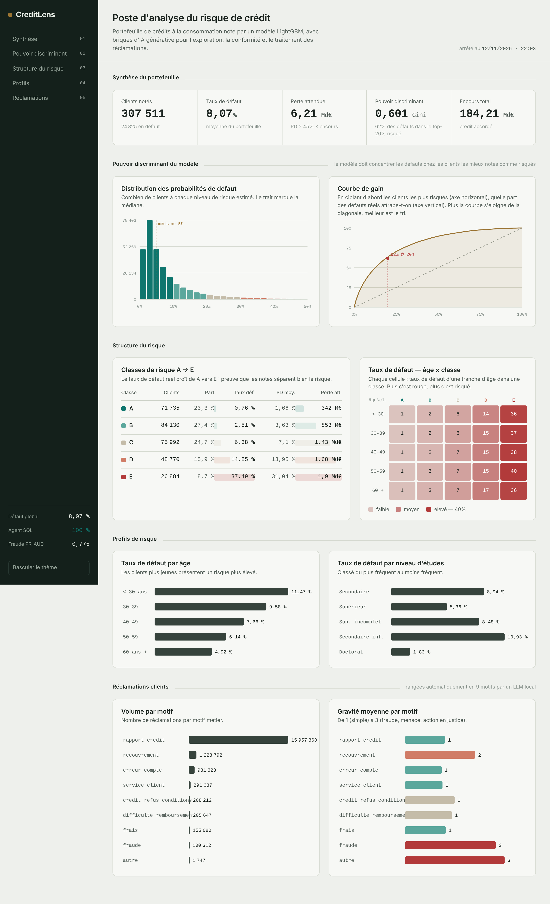

# CreditLens — Analyse du risque de crédit augmentée par l'IA

> Plateforme d'aide à la décision pour le risque de crédit bancaire : elle note chaque
> client, chiffre la perte attendue, classe les réclamations, et met un **agent IA** et un
> **RAG réglementaire** au service d'un analyste — le tout **100 % local et gratuit**.

**Auteur :** Ilyasse Ben Othman · [LinkedIn](https://linkedin.com/in/ilyasse-ben-othman) · élève-ingénieur IMT Mines Albi / Mines Rabat
**Cible métier :** data analyst en banque / risque de crédit



---

## Pourquoi ce projet

Une banque doit répondre à trois questions, chaque jour, sur des milliers de dossiers :
**à qui prêter ? combien peut-on perdre ? et comment le justifier face au régulateur ?**
CreditLens répond aux trois sur un portefeuille réel de **307 511 crédits à la consommation**,
en combinant data engineering, machine learning et IA générative — avec la rigueur attendue
dans le secteur (Bâle III, IFRS 9, AI Act).

## Résultats clés (chiffres réels, recalculés depuis la base)

| Indicateur | Valeur |
|---|---|
| Clients analysés | **307 511** |
| Taux de défaut du portefeuille | **8,07 %** |
| Perte attendue estimée | **6,2 Md€** |
| Pouvoir discriminant du modèle (Gini) | **0,60** — 62 % des défauts dans le top-20 % le plus risqué |
| Séparation du scoring | taux de défaut de **0,76 % (classe A) à 37,5 % (classe E)** |
| Fiabilité de l'agent text-to-SQL | **100 % (30/30 questions-tests)** |
| RAG réglementaire — bon document retrouvé | **100 % (top-1 et top-3)** |
| Détection de fraude (PR-AUC) | **0,78** |
| Réclamations classées automatiquement | **19 080 438 (100 %)** |

Chaque score est **mesuré automatiquement** par une suite d'évaluation (jamais écrit à la main).

## Architecture

```
Données brutes ─▶ Entrepôt PostgreSQL (3 couches : raw / staging / marts)
                        │
     ┌──────────────────┼───────────────────────────────┐
     ▼                  ▼                                 ▼
  Scoring            Perte attendue                  Réclamations
  LightGBM + SHAP    EL = PD × LGD × EAD             classées par LLM local
  (classes A→E)      (logique Bâle / IFRS 9)         (9 motifs, gravité)
     │                  │                                 │
     └──────────────────┴───────────────────────────────┘
                        ▼
         Couche IA (Ollama, 100 % local)
   ┌───────────────┬───────────────┬──────────────────┐
   ▼               ▼               ▼                  ▼
 Agent text-to-SQL  RAG            Note de crédit     Détection
 via serveur MCP    réglementaire  générée            de fraude
 (lecture seule)    (sources citées) (SHAP + LLM)     (Isolation Forest + LightGBM)
                        ▼
              Dashboard web interactif
```

## Briques du projet

1. **Entrepôt de données** — PostgreSQL en 3 couches (raw → staging → marts) sous Docker, chargement ELT.
2. **Scoring de crédit** — modèle LightGBM calibré, explicabilité SHAP, classes de risque A à E.
3. **Perte attendue** — Expected Loss = PD × LGD × EAD, selon la logique Bâle III / IFRS 9.
4. **Réclamations** — 19 M de réclamations rangées dans 9 motifs métier par un LLM local, avec niveau de gravité.
5. **Dashboard web** — page HTML autonome (SVG fait main, sans librairie), pilotée par la base, hébergeable.
6. **Agent text-to-SQL** — pose une question en français, l'agent écrit le SQL et répond ; accès **lecture seule** via un serveur **MCP**. Fiabilité **100 %**.
7. **Note de crédit** — synthèse ACCEPTER / REFUSER générée par le LLM à partir du score et des facteurs SHAP (aucun calcul laissé au LLM).
8. **Évaluation & équité** — suites d'évaluation automatiques + analyse de fairness (parité par genre).
9. **RAG réglementaire** — répond aux questions Bâle III / IFRS 9 / AI Act **en citant la source**. **100 %** de bon document retrouvé.
10. **Détection de fraude** — Isolation Forest (non supervisé) + LightGBM (supervisé) sur transactions par carte, **PR-AUC 0,78**.
11. **Vitrine** — ce README, le dashboard, et la documentation.

## Sécurité de l'agent IA (défense en profondeur)

L'agent n'accède à la base que via un **serveur MCP** qui n'expose que 3 outils en lecture.
Trois barrières empêchent toute écriture, même si le LLM se trompait :
1. un utilisateur PostgreSQL **en lecture seule** (`default_transaction_read_only`, timeout 20 s) ;
2. un **vérificateur SQL** qui refuse tout sauf `SELECT` / `WITH` ;
3. une **limite de 200 lignes** par requête.

## Stack technique

**Data :** PostgreSQL, Docker, SQL, pandas, SQLAlchemy
**ML :** scikit-learn, LightGBM, SHAP, fairlearn (concepts), PR-AUC / AUC-Gini
**IA générative :** Ollama (LLM local `qwen2.5:3b`, embeddings `nomic-embed-text`), MCP, RAG
**Langage :** Python 3.11 · packaging `pip install -e .`

## Démarrage rapide

```bash
# 1. base de données
docker compose up -d

# 2. dépendances
pip install -e .

# 3. construire l'entrepôt, le scoring et la perte attendue
python -m creditlens.run_sql            # schémas + marts
python -m creditlens.risk.train_model   # scoring + SHAP

# 4. briques IA (nécessitent Ollama : https://ollama.com)
ollama pull qwen2.5:3b && ollama pull nomic-embed-text
python -m creditlens.genai.agent "Quel est le taux de défaut des moins de 30 ans ?"
python -m creditlens.genai.rag ask "Que dit l'AI Act sur le scoring de crédit ?"

# 5. évaluations (produisent les scores du tableau ci-dessus)
python -m creditlens.genai.evaluate     # agent : 100 %
python -m creditlens.genai.rag evaluate # RAG : 100 %

# 6. dashboard
python -m creditlens.viz.dashboard      # -> docs/dashboard.html
```

## Dashboard

Page interactive (distribution des PD, courbe de gain, classes de risque, heatmap âge × classe,
profils, réclamations) générée depuis la base. Aucune librairie externe : un seul fichier,
ouvrable hors ligne et hébergeable tel quel.

`python -m creditlens.viz.dashboard` puis ouvrir `docs/dashboard.html`.

---

*Projet personnel de portfolio. Données : jeu Home Credit Default Risk (crédits), CFPB
(réclamations) et ULB (fraude par carte). Toutes les briques d'IA tournent en local, sans API
payante et sans que les données quittent la machine.*
