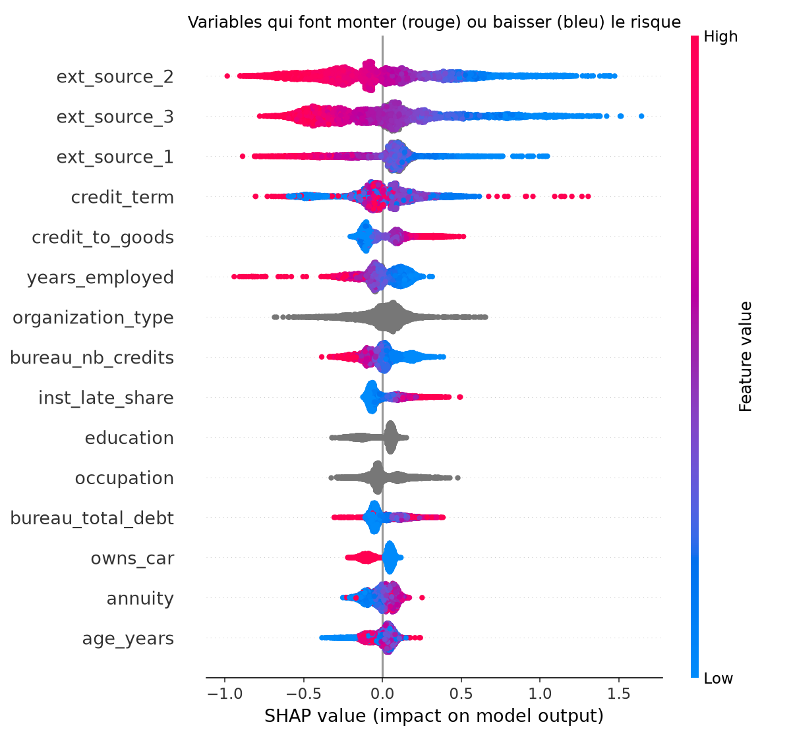

# Modèle de scoring — résultats

| Modèle | AUC | Gini |
|---|---:|---:|
| Régression logistique | 0.753 | 0.506 |
| LightGBM | 0.774 | 0.548 |

**Seuil de refus :** PD > 18.2 % (coût d'un mauvais client accepté = 45% du montant, coût d'un bon client refusé = 10%).

| Indicateur (jeu de test) | Valeur |
|---|---:|
| taux_refus_pct | 10.2 |
| defauts_evites_pct | 36.3 |
| bons_clients_refuses_pct | 7.9 |
| taux_defaut_acceptes_pct | 5.73 |

## Variables les plus importantes (SHAP)

| variable          |   impact_moyen |
|:------------------|---------------:|
| ext_source_2      |         0.3225 |
| ext_source_3      |         0.3120 |
| ext_source_1      |         0.1770 |
| credit_term       |         0.1417 |
| credit_to_goods   |         0.1101 |
| years_employed    |         0.1024 |
| organization_type |         0.0975 |
| bureau_nb_credits |         0.0898 |
| inst_late_share   |         0.0812 |
| education         |         0.0768 |
| occupation        |         0.0751 |
| bureau_total_debt |         0.0719 |
| owns_car          |         0.0676 |
| annuity           |         0.0623 |
| age_years         |         0.0598 |

## Explication de 3 clients

### Client à risque faible : PD = 1.2 % (défaut réel : non)
- `credit_term` = 10.1 → diminue le risque
- `ext_source_3` = 0.6263042766749393 → diminue le risque
- `ext_source_2` = 0.3426678704532639 → augmente le risque

### Client à risque moyen : PD = 4.9 % (défaut réel : non)
- `ext_source_3` = 0.5691487713619409 → diminue le risque
- `goods_price` = 679500.0 → diminue le risque
- `owns_car` = 1.0 → diminue le risque

### Client à risque élevé : PD = 36.6 % (défaut réel : non)
- `ext_source_3` = 0.05028594024754343 → augmente le risque
- `prev_refused_share` = 0.8333 → augmente le risque
- `bureau_nb_active` = 6.0 → augmente le risque

## Contrôle d'équité (le sexe n'est pas une variable du modèle)

### Par sexe

| groupe   |   nb_clients |   taux_defaut_reel_pct |   pd_moyenne_pct |   taux_refus_pct |   auc |
|:---------|-------------:|-----------------------:|-----------------:|-----------------:|------:|
| F        |        40561 |                   6.99 |             7.28 |              8.3 | 0.768 |
| M        |        20940 |                  10.17 |             9.42 |             13.8 | 0.774 |

### Par âge

| groupe    |   nb_clients |   taux_defaut_reel_pct |   pd_moyenne_pct |   taux_refus_pct |   auc |
|:----------|-------------:|-----------------------:|-----------------:|-----------------:|------:|
| 30-44 ans |        24756 |                   8.82 |             8.9  |             12.4 | 0.781 |
| 45-59 ans |        20662 |                   6.89 |             6.58 |              6.4 | 0.765 |
| 60 ans +  |         7270 |                   4.95 |             4.92 |              2.7 | 0.743 |
| < 30 ans  |         8815 |                  11.32 |            11.4  |             18.9 | 0.749 |
